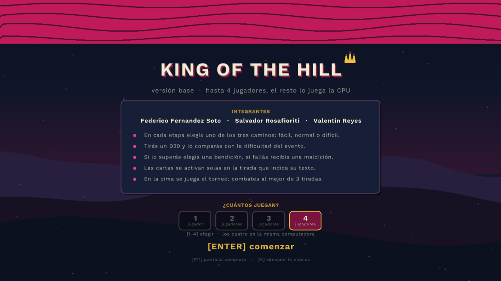

# King of the Hill

Prototipo digital del juego de mesa, en C++ con raylib. **Un jugador contra
tres rivales controlados por la CPU**: exploración de la montaña con eventos de
D20, las 96 bendiciones y maldiciones del diseño con sus efectos reales, y
torneo al mejor de 3 tiradas con batalla final.

**Integrantes:** Federico Fernandez Soto · Salvador Rosafioriti · Valentin Reyes



## Compilar

Abrí `KingOfTheHill.slnx` y compilá en **x64**. No hay nada que configurar:
raylib y las fuentes viajan dentro del repo y el `.vcxproj` las busca con rutas
relativas, así que compila igual en cualquier PC con Visual Studio.

```
King-of-the-Hill/
├── KingOfTheHill.slnx
├── KingOfTheHill.vcxproj          // includes, libs y salidas, todo relativo
├── src/                           // codigo fuente
├── assets/fonts/                  // Work Sans (Regular y Bold) + su licencia
├── assets/audio/                  // musica y efectos (sintetizados para el juego)
├── lib/raylib/
│   ├── include/                   // raylib.h, raymath.h, rlgl.h
│   └── lib/x64/raylib.lib         // raylib 6.0 estatica (msvc)
├── bin/x64/<Config>/              // ejecutable + assets (se genera)
└── obj/x64/<Config>/              // intermedios (se generan)
```

- `Debug` compila **con consola**; `Release`, **sin consola** (subsistema
  Windows con `EntryPointSymbol = mainCRTStartup`).
- `raylib.lib` es la estática: el `.exe` no necesita DLL, sólo la carpeta
  `assets`, que el evento post-build copia al lado del ejecutable.
- Sólo x64. Para Win32 hay que poner la `raylib.lib` de 32 bits en
  `lib\raylib\lib\Win32`.
- En Debug se omite la biblioteca `MSVCRT` para que no choquen dos runtimes
  (la raylib oficial viene compilada contra el runtime release).

## Controles

| Fase | Teclas |
|---|---|
| Menú | `ENTER` empezar |
| Orden de turnos | `ESPACIO` para tirar al empezar la partida |
| Elegir camino | `1` fácil (gris) · `2` normal (rojo) · `3` difícil (púrpura) · `ENTER` confirmar |
| Ver las cartas | `TAB` en cualquier momento · `1`…`4` para ver las de cada jugador |
| Tirar el D20 | `ESPACIO` |
| Elegir carta | `1` · `2` · `3` |
| Enemigo | `1`…`4` elegir la parte · `ESPACIO` atacar · `ENTER` cobrar si ya ganaste |
| Combate | `ESPACIO` por tirada |
| Elegir (cartas que lo piden) | `1` … `5` |
| Pantalla final | `R` jugar de nuevo · `ESC` salir |
| En cualquier momento | `F11` o `Alt+Enter` pantalla completa · `M` silenciar · `ESC` salir (o volver a ventana) |

## Reglas

- **Orden de turnos**: al empezar, los cuatro tiran un D20. El más alto abre la
  partida y lo sigue el jugador de su derecha, como en el manual del juego de
  mesa. Ese orden vale para toda la exploración.
- **Exploración**: 6 etapas que suben de la base a la cima. Cada jugador elige
  libremente uno de los tres caminos y tira un D20 contra la dificultad de la
  casilla (fácil 8, normal 12, difícil 16, con +1 cada dos etapas). La ficha se
  mueve al camino apenas lo elegís, pero podés cambiarlo las veces que quieras
  hasta confirmar con `ENTER`.
- **Eventos y enemigos**: las etapas **1, 3 y 5** son eventos (una sola tirada
  contra la dificultad). Las etapas **2, 4 y 6** son combates contra un enemigo
  (ver más abajo). El resultado reparte carta igual en los dos casos.
- **Consulta de cartas**: `TAB` abre en cualquier momento la lista de cartas de
  cada jugador, con su texto completo y si ya se usaron.
- **Cartas**: se ofrecen 3 del mazo correspondiente, el jugador guarda 1 y las
  otras 2 vuelven al mazo. El camino define el mazo: fácil da comunes, normal
  peligrosas y difícil épicas.
- **Críticos**: 20 natural gana solo, 1 natural pierde solo; en ambos casos se
  ignoran los modificadores.
- **Torneo**: iniciativa de los 4; se cruzan los dos más altos y los dos más
  bajos; después juegan los dos perdedores (3er puesto) y por último los dos
  ganadores. Cada combate es **al mejor de 3 tiradas**, tirada por tirada.
- **Recompensa de combate**: el ganador le roba una bendición al perdedor (es lo
  que da sentido a la carta *Corona rota*, que la bloquea).
- **Pantalla final**: corona al rey de la colina y muestra las cuatro
  posiciones. Con `R` arranca otra partida.

## Jugadores y CPU

El juego es de **un jugador**: los otros tres puestos los maneja la CPU, que
juega con las mismas reglas y las mismas cartas (no hace trampa ni ve nada que
el jugador no vea). Las fichas de CPU están marcadas en el panel de jugadores y
en los combates.

El motor soporta más de un humano (`humanCount` en `GameState`), pero la
interfaz lo deja fijo en 1 porque el diseño es para un jugador.

La CPU piensa medio segundo antes de cada acción para que se pueda seguir lo
que hace, y sus decisiones están en `src/Cpu.cpp`:

- **Camino**: si junta más maldiciones que bendiciones va por el fácil; en las
  dos últimas etapas va al difícil para buscar cartas épicas; si le está yendo
  bien también arriesga. Una de cada cinco veces elige al azar, para que no sea
  siempre igual.
- **Cartas**: puntúa las tres que le ofrecen y se queda con la mejor (o con la
  maldición menos dañina). El puntaje por tipo de efecto está en `ScoreCard`.
- **Elecciones** (Dado Cambiado, Apuesta controlada, Predicción…): toma la
  opción de mayor valor.
- **Enemigos**: pega primero en la parte que cuenta y menos dificultad pide, y
  sólo va por la cabeza cuando le sobran turnos. Con el combate ya ganado se
  retira en vez de arriesgar otra maldición.

Es una CPU de prototipo: alcanza para que una partida de 1 jugador tenga
sentido, pero no planifica a futuro ni mira la mano de los rivales.

## Combate contra enemigos (PvE)

**Esto es provisional.** El documento de diseño deja abiertas las preguntas de
cómo funcionan los enemigos, así que está programada la propuesta de
**[docs/propuesta-combate-pve.md](docs/propuesta-combate-pve.md)** para que el
grupo la pruebe jugando y la corrija. Los números están todos juntos en
`MakeEnemy`, en `src/Enemy.cpp`: cambiarlos es cambiar el juego.

Un enemigo es un conjunto de **partes**. Cada parte pide una dificultad (la del
camino más un ajuste) y aguanta una cantidad de heridas. Cada turno elegís una
parte con `1`…`4`, tirás el D20 con `ESPACIO`, y si igualás o superás la
dificultad le sacás una herida. Si fallás, el enemigo contraataca: te da una
maldición del nivel del camino, sin poder elegir entre tres.

Las partes violetas son las que **cuentan para ganar**; la cabeza es la apuesta:
no hace falta, pero derribarla sube un nivel la bendición de la recompensa. Si
ya ganaste y te sobran turnos podés cobrar con `ENTER` o seguir con `ESPACIO`
para ir por la cabeza, sabiendo que un fallo todavía te cuesta una maldición.

| Etapa | Enemigo | Partes (ajuste / heridas) | Turnos | Hay que derribar |
|---|---|---|---|---|
| 2 | Bestia del camino | Cola −4/1 · Cuerpo −2/1 · **Cabeza** +2/1 | 3 | 2 |
| 4 | Guardián de la ladera | Patas −5/1 · Cuerpo −3/1 · Ala −2/1 · **Cabeza** +2/1 | 5 | 3 |
| 6 | Señor de la cima | Cola −5/1 · Cuerpo −4/1 · Garra −3/1 · **Cabeza** +1/2 | 5 | 3 |

Las tiradas pasan por el mismo motor de cartas que todo lo demás, así que las
bendiciones y maldiciones funcionan igual que en un evento (y el 20 y el 1
naturales siguen decidiendo solos). Sobre 2.400 combates simulados, los tres
enemigos se ganan en torno al 90 % en el camino fácil, 60 % en el normal y 22 %
en el difícil: parecido a la tirada de evento, un poco más generoso para
compensar las maldiciones del contraataque.

Lo que sigue abierto son las cuatro decisiones del final de la propuesta (vida
del jugador, si el PvE reemplaza del todo a los eventos, cuántas partes se
muestran y qué da la cabeza). Hoy están resueltas por defecto: sin vida,
alternando eventos y combates, hasta 4 partes y bendición de un nivel más.

## Las 96 cartas

Están implementadas **las 96**, con su nombre y su texto tal como figuran en
`King of the hill cartas - estado.xlsx`. El catálogo vive en `src/Cards.cpp`:
una fila por carta con su tipo de efecto y sus parámetros. El motor que las
aplica es `src/Effects.cpp`.

La mayoría se activan solas en la tirada que indica su texto. Las que dicen
"elegí" o "podés" abren una pantalla de elección con teclas `1`…`5`:
*Dado Cambiado* (5 variantes), *Fortuna*, *Doble o nada*, *Apuesta controlada*,
*Predicción* y *Destino alterado*.

Orden de resolución de una tirada:

1. **Dados**: cuántos se tiran (`Doble o nada`, `Fortuna`, `Dado Cambiado`),
   bloqueos (`Agotamiento`, `Ancla`) y repeticiones (`Mala racha`).
2. **Conversiones** de un valor por otro (`Maldición del veinte`,
   `Talón de Aquiles`).
3. **Críticos**: 20 natural y 1 natural, que ignoran todo lo demás. Como la
   conversión pasa antes, `Maldición del veinte` sí te arruina un 20.
4. **Restricciones** sobre tus bendiciones (`Cadenas`, `Inercia`, `Bloqueo`,
   `Despojo`).
5. **Cartas del rival que tuercen las tuyas** (`Twisted`, `Negación`).
6. **Cartas que modifican lo que recibís** (`Escudo`, `Eco negativo`).
7. **Castigos por usar bendiciones** (`Peso muerto`, `Fractura`,
   `Desconcentración`, `Riesgo calculado`, `Fractura del destino`).
8. **Sumas y restas**: umbrales, paridad, Fibonacci, historial del combate y
   bonos planos.
9. **Multiplicar y dividir** (`Multiplicar`, `Dividir`, `Juego Seguro`).
10. **Topes** (`Tropiezo`, `Temor`, `Tormenta`, `Punto muerto`) y piso en 1.

Quién gana cada tirada también es configurable: `Justicia Divina` y
`Reverso del destino` hacen ganar al más bajo, `Redistribución de las riquezas`
al más cercano a 10, `Trampa de oso` le pone un mínimo al rival y `En empate`
convierte tus empates en derrotas.

### Supuestos que conviene revisar jugando

Tres cartas quedaron abiertas a interpretación y las resolví así:

- **Apuesta controlada**: la elección es *apostar o no*. Si apostás, 10 o menos
  suma 5 y 11 o más resta 2.
- **Despojo**: como no hay UI para que el rival elija, el juego le bloquea
  automáticamente tu mejor bendición.
- **Corona rota**: implica que ganar un combate da recompensa, cosa que el
  documento no detallaba. Implementé la recompensa como "el ganador roba una
  bendición al azar del perdedor".

Además, **Dado Cambiado** deja el resultado entre 1 y 5 (o 1 y 2): es lo que
dice el texto, pero contra dificultades de 8 a 18 es casi siempre una tirada
perdida. Vale la pena testearla.

## Archivos

| Archivo | Qué hace |
|---|---|
| `src/main.cpp` | ventana y loop principal |
| `src/Types.h/.cpp` | constantes de balance, `CardInstance`, `Player` |
| `src/Dice.h/.cpp` | el D20 y el RNG |
| `src/Cards.h/.cpp` | catálogo de las 96 cartas y los 6 mazos |
| `src/Effects.h/.cpp` | motor de efectos: cómo se resuelve cada tirada |
| `src/Board.h/.cpp` | geometría del tablero vertical, dificultades y dibujo |
| `src/Enemy.h/.cpp` | los enemigos del PvE: partes, heridas y turnos |
| `src/Combat.h/.cpp` | iniciativa y torneo al mejor de 3 |
| `src/Game.h/.cpp` | máquina de estados de la partida y UI |
| `src/Cpu.h/.cpp` | las decisiones de los jugadores controlados por la máquina |
| `src/Ui.h/.cpp` | fuentes y dibujo de todo el texto |
| `src/Theme.h` | la paleta del folleto en un solo lugar |
| `src/Fx.h/.cpp` | fondo, montañas, nieve, paneles, corona y curvas de animación |
| `src/Audio.h/.cpp` | música, efectos y mute |
| `src/Assets.h/.cpp` | dónde buscar los archivos de `assets/` |

Para agregar o cambiar una carta alcanza con tocar su fila en `src/Cards.cpp`.
Si el efecto no entra en los tipos existentes, se agrega al `enum EffectKind` y
su caso en `Effects.cpp`.

Balance concentrado en: `Types.h` (etapas y jugadores), `Board.cpp`
(`GetEventDifficulty`) y el catálogo de `Cards.cpp`.

## Presentación

La paleta sale del folleto del juego: magenta, azul noche y crema, con dorado
para la corona. Está toda en `src/Theme.h`, así que cambiar el look es tocar un
archivo.

- **Fondo** (`src/Fx.cpp`): degradado de cielo nocturno, resplandor magenta sobre
  el horizonte, tres cadenas de montañas y nieve cayendo. Todo dibujado por
  código, sin imágenes.
- **Dado**: al tirar, el número gira medio segundo antes de quedarse quieto, y
  recién ahí entra el sonido del resultado. Durante ese rato no se acepta input,
  así que no se puede saltear la tirada sin querer.
- **Cartel** de ¡ÉXITO! o FALLO que entra con un rebote y se va solo.
- **Tablero**: vertical, en la mitad izquierda de la pantalla. Tres carriles en
  columna que suben de la base a la zona de combate, con el número de etapa al
  costado y la dificultad en cada casilla. Las casillas tienen relieve y el
  borde del color del camino, y la ficha del jugador en turno flota con un
  anillo que late. Los paneles de turno, jugadores y registro viven en la
  columna de la derecha.
- **Enemigo**: ocupa la columna del tablero mientras dura el combate. Una caja
  por parte —cabeza arriba, cola abajo—, con su tecla, lo que pide, sus heridas
  como círculos y un borde dorado que late en la que estás apuntando.
- **Combate**: tres fichas que se van pintando con el color de quien ganó cada
  tirada.
- **Menú y pantalla final**: banda magenta con las curvas del folleto, el título
  con su corona y las posiciones finales en un panel.

Nada de esto usa imágenes: son primitivas de raylib, así que no agrega peso al
repo ni dependencias.

## Pantalla completa y escalado

`F11` (o `Alt+Enter`) pasa a pantalla completa y vuelve; `ESC` también sale de
pantalla completa antes de cerrar el juego. La ventana además se puede
redimensionar a mano.

El juego se dibuja **siempre sobre un lienzo de 1280x720** (`RenderTexture2D`) y
recién al final se escala a la ventana, centrado y conservando la proporción,
con bandas negras si hace falta. Por eso no hay que recalcular ninguna posición:
la interfaz se ve igual en 1280x720 que en 4K. El filtrado es bilineal, así que
al agrandar no queda pixelado.

Lo único que hay que respetar si se agregan pantallas nuevas: usar las
constantes `SCREEN_WIDTH` y `SCREEN_HEIGHT` de `Types.h` y **no** llamar a
`GetScreenWidth()`, que dentro del lienzo devuelve el tamaño de la ventana real
y descoloca el dibujo.

## Audio

La música y los efectos están en `assets/audio` y son **sintetizados a medida
para este proyecto** (no hay samples de terceros, así que no hay problema de
licencia para publicarlo en itch).

| Archivo | Cuándo suena |
|---|---|
| `dice.wav` | al tirar el D20 (exploración, iniciativa y combate) |
| `success.wav` / `fail.wav` | medio segundo después del dado, con el resultado |
| `crit.wav` | 20 natural |
| `card.wav` | al quedarte con una carta |
| `select.wav` | menús, elección de camino y elecciones de cartas |
| `hit.wav` | al comparar las dos tiradas de un combate |
| `victory.wav` | al coronar al rey de la colina |
| `music_explore.ogg` | loop de la fase de exploración (23 s) |
| `music_combat.ogg` | loop del torneo (27 s) |

`src/Audio.cpp` concentra todo: carga, mute con `M`, cambio de pista y una cola
de efectos con retardo (por eso el resultado de la tirada suena *después* del
dado y no encima). Si los archivos no están, el juego arranca igual en silencio.

El estilo es chiptune porque los generé por síntesis. Si consiguen un pack CC0
con mejor producción, alcanza con reemplazar los archivos respetando los
nombres: el código no cambia.

## Fuentes

Todo el texto se dibuja con **Work Sans** (`assets/fonts/`), incluida en el
repo bajo SIL Open Font License 1.1. `src/Ui.cpp` la carga una sola vez con
`LoadFontEx` a 64 px y la busca en la carpeta de trabajo, al lado del ejecutable
y tres niveles arriba; si no la encuentra, usa la fuente por defecto de raylib.

## Para la entrega

En el zip de código fuente van `src/`, `assets/`, `lib/`, el `.slnx` y el
`.vcxproj`. `bin/` y `obj/` se generan al compilar y quedan afuera.
